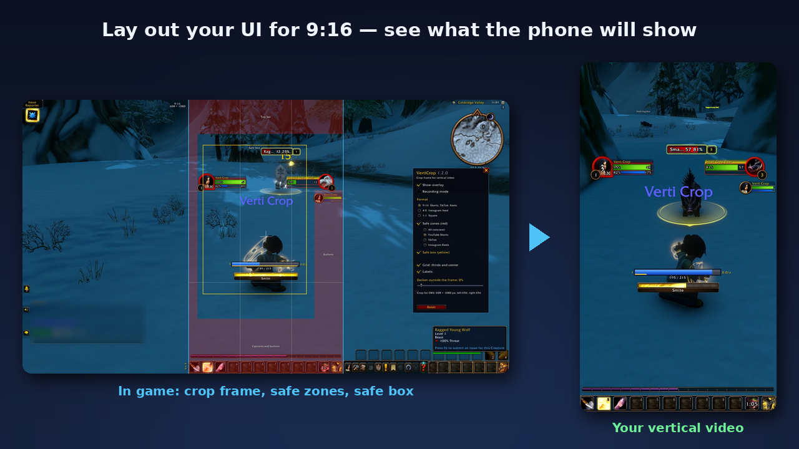
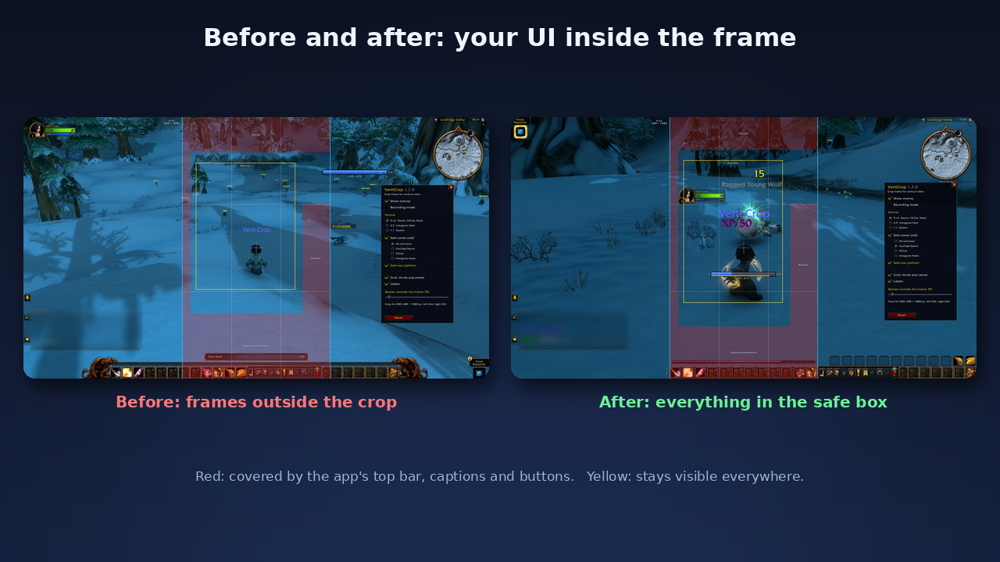
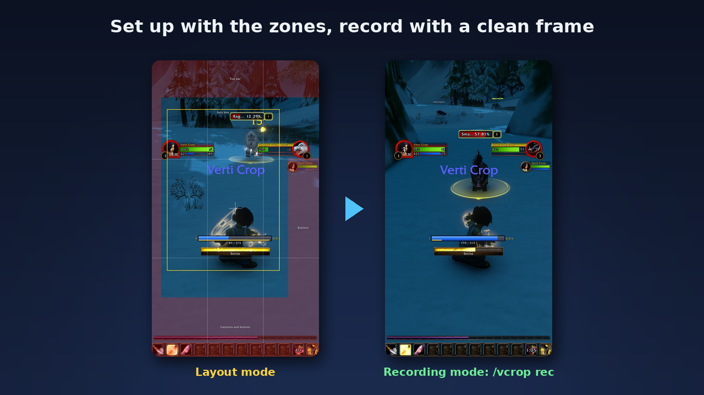

# VertiCrop

**See the 9:16 crop of your vertical video in game — for YouTube Shorts, TikTok and Instagram Reels.**

VertiCrop draws the **9:16 crop frame** over World of Warcraft and marks the **safe zones** of the apps: the top bar, the captions and the like/comment/share buttons that cover your video on the phone. Place your character, cast bar and UI for vertical video **before** you hit record, instead of finding out in the editor that your health bar ended up under the like button.

One download for **Retail (Midnight), Classic Era, TBC Anniversary, Wrath and Cataclysm Classic, Mists of Pandaria Classic and WoW Forever**. Tested in game on **WoW Forever, Classic Era, TBC Anniversary and Mists of Pandaria Classic**; on Retail, tell us how it works for you.

*Features asked for in the comments get built. Tell us what you need: comment here or open an issue on [GitHub](https://github.com/KesaObscura/VertiCrop/issues).*

## What it does

- **9:16 crop frame** in the middle of your screen, full screen height. Also **4:5** (Instagram feed), **1:1** (square) and **16:9** for ultrawide screens (21:9, 32:9): the part a normal YouTube video keeps.
- **Darkened outside the frame** (0–100 %): you see at a glance what stays in your video.
- **Dead zones** (red) — the safe-zone margins of **YouTube Shorts**, **TikTok**, **Instagram Reels**, or **All** — the largest margin of every side, safe for posting the same clip everywhere.
- **Safe box** (yellow): keep what matters inside it and it stays visible even with long captions, automatic subtitles and on tall phones (19.5:9, 20:9) that cut the sides of a 9:16 video. Above the side buttons it steps out to the right, so the top right corner is usable (for example for the target frame).
- **Grid**: rule-of-thirds lines and a center cross to place your character.
- **Move combat text**: the game's own floating combat text about you (damage taken, heals received) starts where you drag it — off your character, next to your unit frames, wherever it reads best in the clip — and is drawn above other frames. Font, colours and float mode stay the game's (its self combat text must be on in the game options); switched off, the game's own place comes back.
- **Recording mode**: one key hides everything inside the frame. Only the dark sides and a thin border stay — **outside** the frame, so cropping cuts them away. Record with the frame on. The same key ends it with the overlay hidden: no zones flash at the end of a clip or a saved replay.
- **Crop values for OBS** in pixels (width, height, left, right; top and bottom when the screen is narrower than the format): enter them in the crop of the game capture item in OBS (*Edit Transform*, Ctrl+E) or in your video editor. `/vcrop px` prints them.
- **Sharp at any UI scale**: lines are 1–2 screen pixels thick, the frame follows resolution and UI scale changes.
- **Off at every login**: a tool for setting up and recording, not for playing — `/vcrop` or your key binding switches it on, all other settings are kept.
- **Settings window** with an explanation on every option: `/vcrop opt`, the game's *Options → AddOns*, or, on Retail and WoW Forever, the addon menu at the minimap (left click: settings, right click: overlay on/off).
- **Key bindings**: overlay on/off, recording mode on/off, settings.
- Never touches your UI: it only draws on top of the screen and lets every mouse click through.
- 9 languages: English, Deutsch, Español, Français, Русский, 한국어, Português, 简体中文, 繁體中文.

## How to use it

1. `/vcrop opt` — choose the format and the platform.
2. Move your UI so that what matters is inside the yellow safe box and out of the red. On Retail and WoW Forever save a separate **Edit Mode layout just for recording**; on Classic use your UI addon (for example MoveAny or Bartender).
3. Optional: tick **Move combat text**, click *Move...* and drag the box to where your own damage and heal numbers should start. Numbers over enemies are drawn by the game and cannot be moved.
4. `/vcrop rec` or your key binding — record the full screen: in OBS a *Game Capture* source (or a *Window Capture* of the game, client area only).
5. Crop the recording with the values from `/vcrop px` (in your editor, or in OBS, see below) and scale it to 1080×1920. On a 1080p screen the 9:16 crop is only 608×1080; a 1440p screen gives a sharper clip.

## Tips for a UI that reads on a phone

- **Out of the frame:** chat, minimap, quest tracker, bags, micro menu and every action bar you do not press in the clip.
- **In the safe box:** player and target frame (the target frame left of the button zone), a bigger cast bar, one small bar with the 4–6 spells the clip is about.
- **Bigger:** a phone shows the frame at about a third of your monitor's width — raise the scale of what you keep.
- **Camera** a bit closer than usual, the character slightly below the middle of the frame.

## Recording straight to 9:16 in OBS

- **Crop afterwards:** record the full screen in recording mode and crop in your editor with the values from `/vcrop px`. The crop is centred, so a 9:16 project with "fill" gives the same picture.
- **Vertical canvas:** set a 1080×1920 canvas in OBS (or a second vertical canvas: the Aitum Vertical plugin or the vertical output of newer OBS), add the game capture, right-click it → *Transform → Edit Transform* (Ctrl+E), enter the values from `/vcrop px` in *Crop*, then *Transform → Stretch to screen*: OBS records a ready vertical file. **Not as a *Crop/Pad* filter**: a filter belongs to the source and crops it on every canvas, your 16:9 stream too.
- **Templates for your editor:** transparent 1080×1920 PNGs with the same dead zones and safe box, one per platform, on [GitHub](https://github.com/KesaObscura/VertiCrop/tree/main/docs/templates). Put one on top of your clip in CapCut, DaVinci Resolve or Premiere.
- **Streaming in 16:9 at the same time:** your viewers see the overlay too. Lay out your UI with it, then switch it off with `/vcrop`; the crop values stay the same.
- The values count in pixels of the game window: if OBS records in another resolution, scale them by the same factor. On a 1366×768 laptop the 9:16 crop is only 432×768.

## Commands

| Command | Does |
|---|---|
| `/vcrop` | overlay on/off (it starts off at every login) |
| `/vcrop rec` | recording mode on/off |
| `/vcrop opt` | settings window |
| `/vcrop px` | crop values for OBS in pixels |
| `/vcrop 9:16` / `4:5` / `1:1` / `16:9` | switch the format |
| `/vcrop reset` | all settings back to the defaults |

## About the safe zones

The safe zones are rounded from measured 1080×1920 layouts of YouTube Shorts, TikTok and Instagram Reels. The apps change their layout from time to time, so treat them as a guide and check your video in the app before you post. Spotted a zone that is off? Tell us in the comments.

## FAQ

- **Does the frame end up in my video?** Not inside the crop: in recording mode everything VertiCrop draws sits outside the frame. Keeping the full 16:9 recording too, or streaming it? Switch the overlay off with `/vcrop` (at 0 % darkening the thin border still shows).
- **Does it move or hide my UI?** No. It only draws on top (it moves only the game's combat text, if you tick *Move combat text*).
- **Which game versions?** Retail, Classic Era, TBC Anniversary, Wrath and Cataclysm Classic, Mists of Pandaria Classic and WoW Forever, from one download.

## Bug reports

Please include your game version, your screen resolution, what you did and what you expected. Lua errors are easiest to read with BugGrabber + BugSack.

Source code and issues: [GitHub](https://github.com/KesaObscura/VertiCrop).

Vollständig auf Deutsch · Totalmente en español · Entièrement en français · Полностью на русском · 한국어 완전 지원 · Totalmente em português · 完整简体中文 · 完整繁體中文 — the addon follows your game language.
