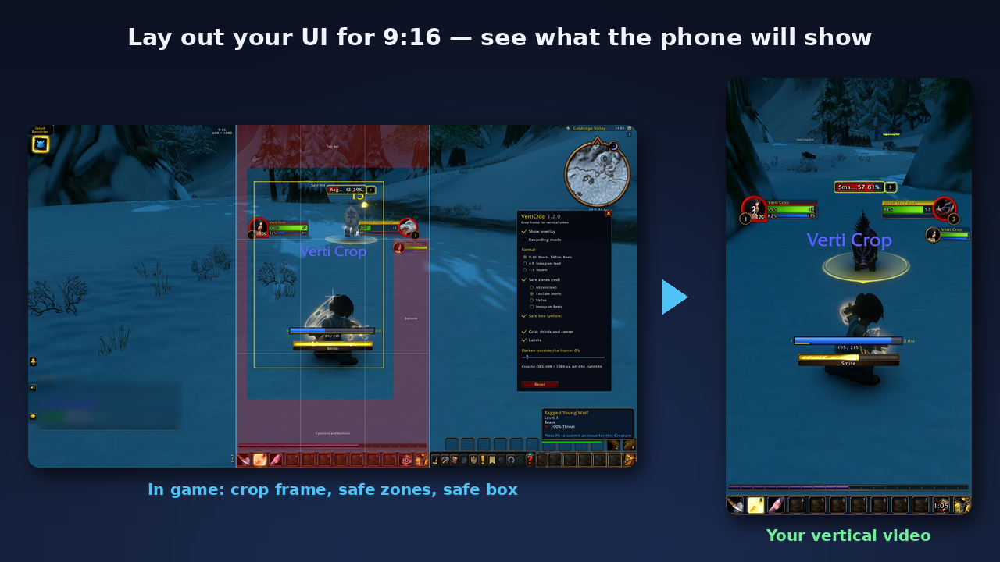
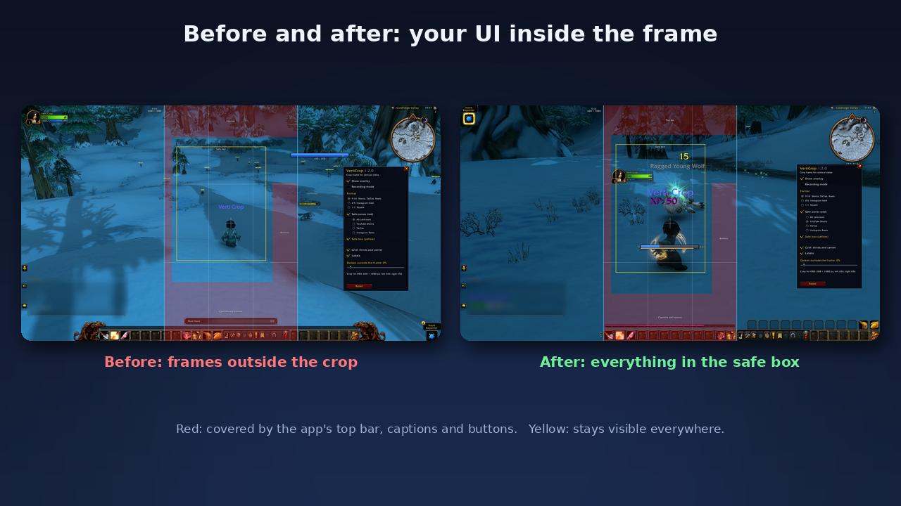
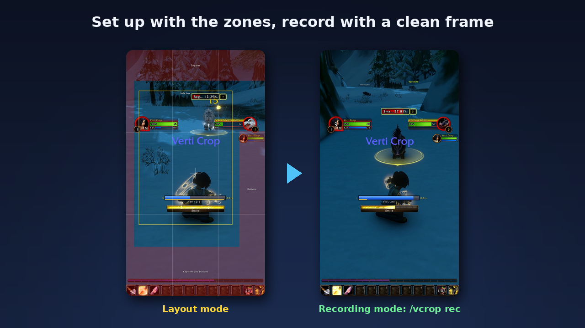
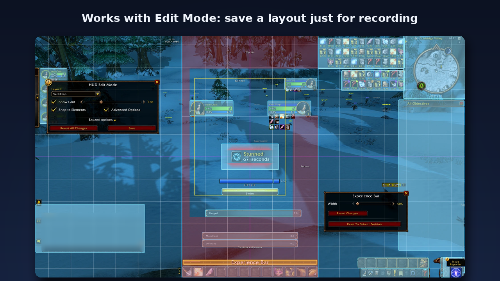

# VertiCrop – 9:16 vertical crop frame for YouTube Shorts, TikTok and Reels in World of Warcraft

[](https://github.com/KesaObscura/VertiCrop/releases/latest)
[](https://www.curseforge.com/wow/addons/verticrop)
[](LICENSE)

A World of Warcraft addon for **content creators**. It draws the **9:16 crop frame** of a vertical
video over the game and marks the **safe zones** of **YouTube Shorts, TikTok and Instagram Reels**:
the parts the app covers with its top bar, captions and buttons. Place your character, cast bar,
unit frames and the rest of your UI for vertical video **before** you record, instead of finding
out in the editor that the important part ended up under the like button.

One download for **Retail (Midnight), Classic Era, TBC Anniversary, Wrath and Cataclysm
Classic, Mists of Pandaria Classic and WoW Forever**. 9 languages. Tested in game on WoW Forever,
Classic Era, TBC Anniversary and Mists of Pandaria Classic; Retail is not tested yet.



| Before and after | Layout and recording mode | Works with Edit Mode |
|---|---|---|
|  |  |  |

## Features

- **9:16 crop frame** in the middle of the screen, full screen height. Also **4:5** (Instagram feed),
  **1:1** and **16:9** for ultrawide screens (21:9, 32:9).
- **Darkened outside** (0–100 %), so you see at once what stays in the video.
- **Dead zones** (red): the safe-zone margins of YouTube Shorts, TikTok, Instagram Reels, or **All** (the largest margin
  of every side), with names on them.
- **Safe box** (yellow): keep what matters inside it and it stays visible even with long
  captions, automatic subtitles and on tall phones (19.5:9, 20:9) that cut the sides of a 9:16
  video. Above the side buttons it steps out to the right, so the top right corner is usable.
- **Grid**: rule-of-thirds lines and the center cross.
- **Recording mode**: hides everything inside the frame. Only the dark sides and a thin border
  stay, **outside** the frame, so cropping the recording cuts them away. Record your gameplay with
  the frame on.
- **Crop values for OBS** in pixels: width, height, left, right (`/vcrop px` or the settings
  window). Put them into a *Crop/Pad* filter on your game capture, or into your video editor.
- Lines stay 1–2 screen pixels thick at any UI scale; the frame follows resolution and UI scale
  changes.
- **Off at every login**: a tool for setting up and recording, not for playing. `/vcrop` or your
  key binding switches it on; all other settings are kept.
- **Settings window** (`/vcrop opt`), also in the game's *Options → AddOns* and in the addon menu
  at the minimap. Every option explains itself on hover.
- **Key bindings** (*Options → Key Bindings → VertiCrop*): overlay on/off, recording mode on/off,
  settings.
- 9 languages: English, Deutsch, Español, Français, Русский, 한국어, Português, 简体中文, 繁體中文.
  The addon follows your game language.

The safe zones are **approximate**: they are rounded from measured 1080×1920 layouts of the apps,
and the apps change their layout from time to time. Check your video in the app before you post.

## How to use it

1. `/vcrop opt`, choose the format and the platform.
2. Move your UI (Edit Mode on Retail, your UI addon elsewhere) so that what matters is inside the
   frame and out of the red.
3. `/vcrop rec` (or the key binding) and record.
4. In OBS or your editor crop the recording with the values from `/vcrop px`.

## Tips for a UI that reads on a phone

- Out of the frame: chat, minimap, quest tracker, bags and the micro menu, and every action bar
  you do not press in the clip. They only cost space on a phone screen.
- In the safe box: player and target frame (the target frame left of the button zone), your cast
  bar, made bigger, and one small bar with the 4–6 spells the clip is about.
- Raise the UI scale or the scale of the frames you keep: a phone shows the frame at about a
  third of your monitor's width.
- Camera a bit closer than usual, the character slightly below the middle of the frame.

## Recording straight to 9:16 in OBS

- **Crop afterwards:** record the full screen with recording mode on, then crop with the values
  from `/vcrop px` (a *Crop/Pad* filter, or your editor).
- **Vertical canvas:** set the OBS canvas (or a second vertical canvas, for example with the
  Aitum Vertical plugin) to 1080×1920, add your game capture, apply the *Crop/Pad* values from
  `/vcrop px` and scale the capture to fill the canvas. OBS then records a ready vertical file.

## Commands

| Command | Does |
|---|---|
| `/vcrop` | overlay on/off (it starts off at every login) |
| `/vcrop rec` | recording mode on/off |
| `/vcrop opt` | settings window |
| `/vcrop px` | crop values for OBS in pixels |
| `/vcrop 9:16` / `4:5` / `1:1` / `16:9` | switch the format |
| `/vcrop reset` | all settings back to the defaults |

`/verticrop` works as well.

## FAQ

- **Does the frame end up in my video?** Not inside the crop. In recording mode everything the
  addon draws sits outside the frame, and the crop cuts it away. If you also keep the full 16:9
  recording, set the darkening to 0 % or switch the overlay off with `/vcrop`.
- **Does it change my UI?** No. It only draws on top of the screen; it never moves, hides or
  resizes other frames, and it does not take mouse clicks.
- **Which game versions?** Retail, Classic Era, TBC Anniversary, Wrath and Cataclysm Classic, Mists of Pandaria Classic and WoW Forever, from
  one download.
- **Missing a platform or a format?** Open an issue: requests are read.

## Install

Install it from [CurseForge](https://www.curseforge.com/wow/addons/verticrop) (the CurseForge app keeps it up to date), or download a release zip and
unpack it into `<game folder>/_retail_/Interface/AddOns/` (or `_classic_era_`, `_classic_`, or your
WoW Forever client folder). The result must be `Interface/AddOns/VertiCrop/VertiCrop.toc`. With
GitHub's "Download ZIP", rename the folder from `VertiCrop-main` to `VertiCrop`, otherwise the game
does not load it.

## Bug reports

Please open an [issue](https://github.com/KesaObscura/VertiCrop/issues) with your game version
(Retail, Classic Era, ...), your screen resolution, what you did and what you expected. Lua errors
are easiest to read with BugGrabber + BugSack.

## Development

Plain Lua 5.1, no libraries. Files load in TOC order: `Locale.lua` → `Core.lua` → `Options.lua`;
`Bindings.xml` is loaded by the game. Checkboxes, radio buttons and the slider are built from
textures every client ships, not from Blizzard templates, because those differ between game
versions.

Tests run outside the game against a small mock of the WoW API:

```
lua5.1 tests/run.lua
```

They cover the frame and safe-zone geometry, the OBS pixel values, the overlay in every mode, the
settings window (every control has a tooltip), slash commands, key bindings, the TOC and the locale
tables (every language has every key with the same placeholders). The `tests` folder is not part of
the release zip (see `.pkgmeta`).

**Translations**: all texts are in `Locale.lua`. Every language must have exactly the keys of `enUS`
with the same `%d` placeholders; `tests/run.lua` checks that.

## License

[MIT](LICENSE)
